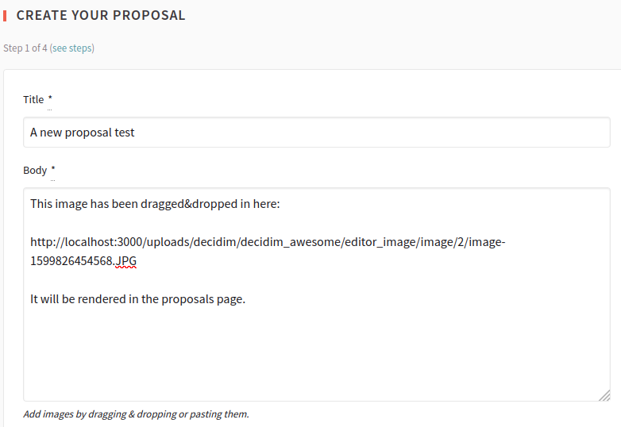
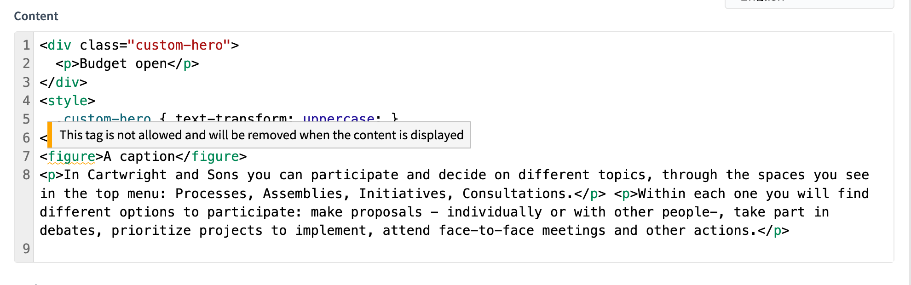

# Editor and content creation

## Tweaks

### 1.1 Image support for the RichText editor

Adds image upload and drag & drop support to the WYSIWYG editor used in admin/public rich text contexts.
The uploaded images are stored as external resources (not base64 inline content).

#### Admin description

Enables editorial teams to embed images directly in rich text areas without reverting to external hosting or links.
Concerns include storage quota management and image moderation workflows.
Recommend enabling image upload size limits in administration settings to prevent storage overflow.

#### Technical area

- **Configuration:** Via initializer (affects default state; admins can always restrict scope)

```ruby
# config/initializers/awesome_defaults.rb
Decidim::DecidimAwesome.configure do |config|
  # true = enabled by default globally (admins can restrict to specific scopes)
  # false = disabled by default (admins CAN enable using scope restrictions)
  # :disabled = completely removed, hidden from admins
  config.allow_images_in_editors = false  # default: false
end
```

- **Admin visibility:** Enabled (admins see Settings → Ckeditor options toggle)
- **Default behavior:** Disabled by default; admins can enable using scope restrictions (see [Global mechanisms](global-mechanisms.md))
- **Admin control:** Yes; toggle on/off and apply scope restrictions (see [Global mechanisms](global-mechanisms.md))
- **Performance:** Minimal impact; images stored as URLs, not base64. Monitor file storage quotas periodically.
- **Prerequisites:** Valid file storage backend configured (local, S3, etc.)
- **Moderation:** Images are subject to standard content moderation policies; no special review needed


### 1.2 Images in proposals

Allows users to drag & drop images into proposal textareas even when public rich text is not enabled.
Useful when proposals use plain text input but still need media attachments.

#### Admin description

Balances structured proposal text with visual content from participants. Reduces friction for visual storytelling.
Concerns: manage image quality expectations and moderation volume. Combined with Tweak 2.1 (custom fields), can structure images alongside metadata.
Recommend clear guidelines for image size and format in help text.

#### Technical area

- **Configuration:** Via initializer or admin panel per component

```ruby
# config/initializers/awesome_defaults.rb
Decidim::DecidimAwesome.configure do |config|
  # true = enabled by default globally (admins can restrict to specific scopes)
  # false = disabled by default (admins CAN enable using scope restrictions)
  # :disabled = completely removed, hidden from admins
  config.allow_images_in_proposals = false  # default: false
end
```

- **Admin visibility:** Enabled (admins see Settings → Components toggle per proposal component)
- **Default behavior:** Disabled by default; admins can enable using scope restrictions (see [Global mechanisms](global-mechanisms.md))
- **Admin control:** Yes; toggle on/off and apply scope restrictions (see [Global mechanisms](global-mechanisms.md))
- **Storage:** Same backend as editor images; validate combined quota limits if both tweaks enabled
- **Performance:** Negligible impact; images indexed alongside proposals for search
- **Moderation:** Follows standard proposal moderation workflow; images included in admin review



### 1.3 HTML code editor in the admin

Replaces the WYSIWYG editor with an HTML code editor (CodeMirror 6) in the admin, so the markup is written and saved as is.
The public editors used by participants are never replaced.

#### Admin description

Useful for pages and descriptions that need markup the WYSIWYG editor cannot produce, such as custom containers with CSS classes.
Tags that are not allowed are underlined in the code editor, as they are removed when the content is displayed.
Content written in the code editor can lose its markup if it is saved again from the WYSIWYG editor, so avoid enabling and disabling the option for the same content.
The "Preview" button shows the content as visitors see it, without the tags that are not allowed.
The "Upload file" button, or dropping a file in the editor, stores the file and adds the tag pointing to it: an image tag for images, a link for the rest.
The Tab key indents the code; press Escape and then Tab to leave the editor with the keyboard.

#### Technical area

- **Configuration:** Via initializer (affects default state; admins can always restrict scope)

```ruby
# config/initializers/awesome_defaults.rb
Decidim::DecidimAwesome.configure do |config|
  # true = enabled by default globally (admins can restrict to specific scopes)
  # false = disabled by default (admins CAN enable using scope restrictions)
  # :disabled = completely removed, hidden from admins
  config.html_code_editor = false  # default: false

  # Extra HTML tags kept when displaying content written by admins,
  # added to the ones Decidim already allows
  config.html_code_editor_allowed_tags = %w(style)  # default: ["style"]

  # Content types of the files admins can upload from the code editor.
  # An empty list turns the uploads off
  config.html_code_editor_allowed_mime = %w(image/jpeg image/png image/gif image/webp)  # default: these four
end
```

- **Admin visibility:** Enabled (admins see Editor Hacks → toggle)
- **Default behavior:** Disabled by default; admins can enable using scope restrictions (see [Global mechanisms](global-mechanisms.md))
- **Admin control:** Yes; toggle on/off and apply scope restrictions (see [Global mechanisms](global-mechanisms.md))
- **Scope:** `html_code_editor_allowed_tags` is set only in the initializer. The extra tags are kept only in the pages where the code editor applies, in the admin and in the public site; a public page out of the participatory spaces follows the "Everywhere except participatory spaces" restriction. If the option stops applying to a page, the extra tags are removed there and their content is displayed as text
- **Uploads:** `html_code_editor_allowed_mime` is set only in the initializer. A content type is accepted only if the organization also accepts it from admins (file upload settings in the system panel), so the list can narrow that policy but not widen it. Size limits are the ones of the organization. Anyone who can write in the admin editors can upload. Do not add `image/svg+xml`, `text/html` or script content types to the list: they can carry JavaScript
- **Security:** The extra tags are kept by page, not by author. Proposals written by participants never get them, but Decidim displays some other content with the rules for admins, and it gets the extra tags where the option applies: initiative descriptions, blog posts written by participants, answers written by evaluators, and budget projects or accountability results imported from proposals. Restrict the option to the spaces where only admins write this content. Do not add `script`, `base` or form tags to the list: they would be published as written, also in that content
- **Compatibility:** Rules inside a `<style>` tag apply to the whole page; Decidim escapes `<`, `>` and `&` inside it, so rules that use them (like `.menu > li`) do not work there
- **Performance:** Minimal impact; the code editor is loaded on demand, only in the admin pages that render an editor
- **Cross-references:** Use Tweak 4.1 (custom CSS, see [UI, theming and navigation](ui-theming-navigation.md)) for the CSS rules that cannot go in a `<style>` tag


